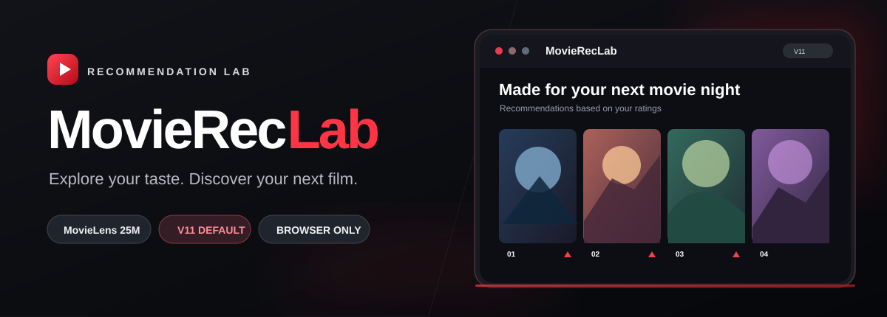
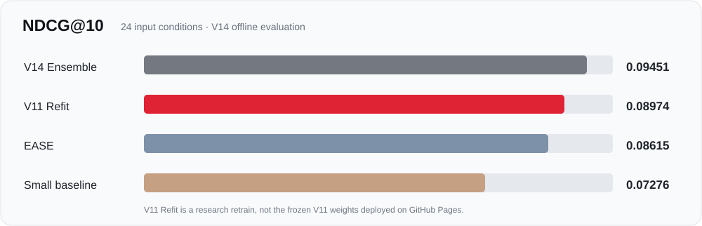

  

**영화를 평가하고, 추천 알고리즘을 바꾸고, 결과를 비교해 보세요.**

[**웹사이트 열기**](https://oyueo-mm.github.io/MovieRecLab/) · [추천 모델 연구](#추천-모델의-발전) · [기술 문서](#기술-문서)

`MovieLens 25M` · `V11 기본 추천` · `JavaScript` · `GitHub Pages`

---

## 어떻게 사용하나요?

| 01. 영화 평가 | 02. 추천 확인 | 03. 직접 비교 |
| :---: | :---: | :---: |
| 별점 3편 이상 입력 | 내 취향에 맞는 영화 탐색 | 알고리즘과 추천 결과 비교 |
| ⭐ 0.5점 단위 드래그 | 🎬 영화 포스터 캐러셀 | 📊 추천 성능과 시각화 |

**빠른 체험:** 영화 12편의 평점이 준비된 **8가지 취향 프리셋**을 선택하면 바로 추천을 확인할 수 있습니다.

## 주요 기능

| | 기능 | |
| :---: | --- | --- |
| 🎞️ | **개인화 영화 추천** | 브라우저에서 작동하는 V11 기반 추천과 기존 모델 비교 |
| ⭐ | **영화 평가** | 전체 영화 탐색, 검색, 별점 드래그, 내 평가 관리 |
| 🧭 | **다양한 추천 영역** | 내 취향 · 유사 취향 사용자 · 비슷한 영화 · 숨은 명작 · 새로운 취향 · 선호 장르 |
| 📈 | **추천 알고리즘 실험** | EASE, SLIM, KNN, SVD 등 모델 선택과 오프라인 성능 평가 |
| 🕸️ | **데이터 시각화** | 영화 취향 맵, 영화 연관망, 평점·장르 분석 |
| 🇰🇷 | **한국어 우선 표시** | 한국어 제목과 줄거리를 우선 표시하고 원제로 전환 가능 |

## 추천 모델의 발전

| 버전 | 변화 | 상태 |
| :--- | --- | :--- |
| **V8** | MovieLens Small 기반 추천 | 비교용 |
| **V9** | MovieLens 25M · Tag Genome · 협업 임베딩 | 비교 가능 |
| **V10** | Tag Genome + Item KNN 하이브리드 | 폴백 |
| **V11** | 입력한 영화 수에 따라 개인화·인기도 가중치 조절 | **기본 추천** |
| **V12** | 숨은 명작 · 새로운 취향 · 선호 장르 추천 영역 추가 | 서비스 기능 |
| **V13–V14** | 모델·가중치·앙상블 성능 탐색 | **오프라인 연구** |
| **V15–V17** | 시네마틱 UI · 전체 영화 탐색 · 별점 드래그 | UI 개선 |

기본 추천은 **V11**을 우선 사용합니다. 해당 입력 조건에서 V11이 채택되지 않았거나 25M 데이터를 활용하기 어려우면 **V10 또는 기존 Small 모델**로 전환합니다.

## 추천 성능

  

**MovieLens 25M · 24가지 입력 영화 수 · NDCG@10 평균.** V14 연구 환경의 비교 결과입니다. **V11 수치는 연구에서 재학습한 모델의 값**으로, 사이트에 배포된 기존 V11 가중치의 성능을 직접 측정한 값은 아닙니다. V13·V14 연구용 앙상블은 현재 사이트에 배포하지 않았습니다.

[실험 기록 보기](https://github.com/oyueo-mm/MovieRecLab/actions/runs/43748965314)

## 데이터와 실행 환경

| 구분 | 사용 기술 |
| --- | --- |
| **데이터** | MovieLens latest-small · MovieLens 25M · Tag Genome |
| **프런트엔드** | Vanilla JavaScript · HTML · CSS |
| **추론** | 사전 학습한 압축 모델 · Web Worker |
| **학습 및 검증** | Python · GitHub Actions |
| **배포** | GitHub Pages — 별도 추천 서버 없이 실행 |

MovieLens 25M의 원본 사용자 평점 행렬 전체를 브라우저에 배포하지 않습니다. 데모에서 입력한 별점은 새로고침하면 초기화됩니다.

## 기술 문서

<b>추천 모델 · 평가 및 구현 문서</b>

- [V9 — 25M & Tag Genome](docs/ml25m-v9.md)
- [V10 — 모델 비교 실험](docs/v10-model-tournament.md)
- [V11 — 콜드 스타트 적응형 추천](docs/v11-adaptive-cold-start.md)
- [V12 — 추천 영역 확장](docs/v12-three-rails.md)
- [V14 — 종합 모델 연구](https://github.com/oyueo-mm/MovieRecLab/blob/research/v14-finalization/docs/comprehensive-v14.md)
- [V15 — 영화 상세와 시네마틱 화면](docs/v15-korean-synopsis-autoplay.md)
- [V16 — 전체 영화 탐색](docs/v16-all-films-gallery.md)
- [V17 — 별점 드래그](docs/v17-rating-drag.md)
- [기존 README 기술 설명 전체 보관본](docs/README-legacy-technical.md)

<b>로컬 실행</b>

저장소를 내려받은 뒤 루트에서 `python -m http.server 8000`을 실행하고 `http://localhost:8000`에 접속하세요. 메인 페이지는 영화 추천 쇼케이스로 이동합니다. MovieLens 데이터를 불러오려면 네트워크 연결이 필요합니다.

---

데이터: [GroupLens MovieLens](https://grouplens.org/datasets/movielens/) · 영화 포스터 및 외부 상세정보는 각 제공처의 조건에 따릅니다. MovieRecLab은 교육·연구용 프로젝트이며 MovieLens/GroupLens의 공식 서비스가 아닙니다.

**[MovieRecLab 바로 체험하기](https://oyueo-mm.github.io/MovieRecLab/)**

